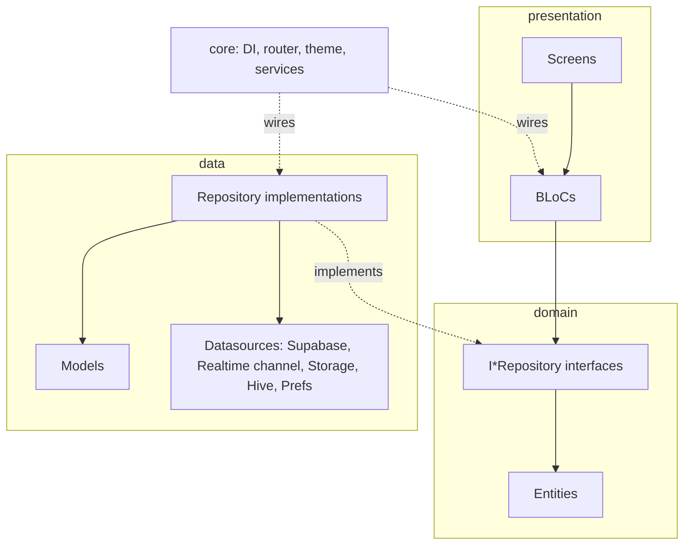
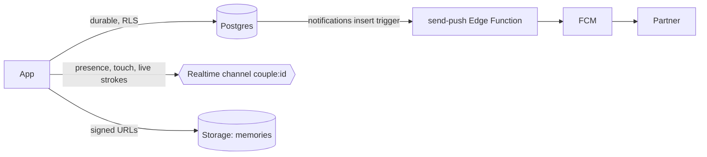
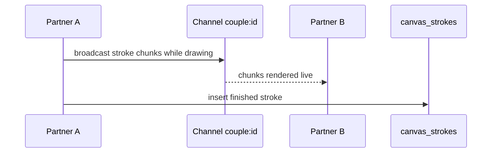

# Architecture

## Layers

| Layer | Path | Rule |
|---|---|---|
| Domain | `lib/domain/` | Pure Dart. Entities and `I*Repository` interfaces. No Flutter, no Supabase imports. |
| Data | `lib/data/` | Implements domain interfaces. Models convert to/from entities. Only layer that talks to Supabase/Hive. |
| Presentation | `lib/presentation/features/<feature>/{bloc,screens}` | BLoCs depend on interfaces only, obtained through GetIt. Shared widgets/painters in `presentation/shared/`. |
| Core | `lib/core/` | DI (`injection.dart`), go_router + guards, five themes, constants, services (push, outbox, app lock, home widget, location sync). |

State management is BLoC; repositories are lazy singletons bound to their interface, BLoCs are **factories** (fresh instance per screen). Only `AuthBloc`, `SettingsBloc`, `ThemeBloc` are app-wide.

## Data split

- **Postgres** holds anything that must survive: profiles, couples, moods, memories, milestones, notifications, canvas strokes, locations, question answers, bucket items. Every row carries `couple_id`; RLS uses `is_couple_member` / `is_active_couple_member`.
- **Realtime** carries ephemeral state on one private channel per couple. Access is enforced by policies on `realtime.messages`. Finished strokes are then persisted.
- **RPCs** (`join_with_code`, `disconnect_couple`, `delete_my_account`, `set_relationship_mode`, `set_next_meet`, `set_bucket_item_done`; plus `get_app_config` and `get_access` for the subscription groundwork) own couple state transitions; clients cannot write those tables directly.

## Realtime canvas flow

## Resilience

- **Outbox** (`core/services/outbox_service.dart`): offline changes are queued in Hive and replayed in order; handlers are idempotent (ids chosen at creation time).
- **Caches**: session, identity, TTL and signed-URL caches cut round trips (see `test/core/`).
- **Presence-based touch end**: there is no `onDisconnect`, so touch stops when the partner's Presence leaves.

## Auth & routing

Google sign-in (native picker -> `signInWithIdToken`). `handle_new_user` trigger creates the `profiles` row. `RouteGuards.redirect` gates routes on the Supabase session; pairing routes are always reachable.

## Decisions

See [docs/adr/](adr/): Supabase over Firebase, BLoC + GetIt, RLS-first security, Realtime vs Postgres split.
