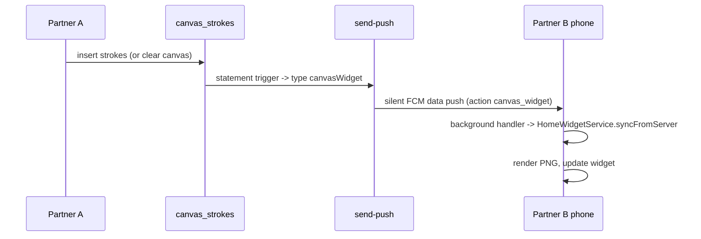

# Feature: Android home-screen widget (Live Doodle)

A 3x3 resizable home-screen widget that shows the couple's shared drawing and opens the app when tapped. Android only.

---

## Components

| Piece | Role |
|---|---|
| `HomeWidgetService` (`core/services`) | Renders the strokes to a 600x600 PNG and tells the widget to update |
| `DoodleWidgetProvider.kt` | Native provider: reads `doodle_path` / `doodle_updated` and displays the picture (or an empty "Draw together" state) |
| `res/xml/doodle_widget_info.xml` | Widget metadata (3x3 cells, resizable, `updatePeriodMillis=0`: updates are pushed, not polled) |
| `notify_canvas_widget` trigger | Fires a silent push when strokes are inserted or deleted |

## Flow

Also refreshes on app launch and on every resume (at most once per 30 s).

## Details

- Strokes are stored in the drawer's screen pixels, which differ per phone, so the picture is framed by the drawing's own bounding box and scaled to fit with a margin.
- `syncFromServer` also runs in the push background isolate where GetIt is not set up, so it initialises Supabase itself, reads `profiles.couple_id`, then `canvas_strokes`.
- The push is data-only (no notification, no inbox row), statement-level so a batch of strokes is one call, and a failure never blocks the canvas write.
- Best effort: any failure leaves the previous picture in place. An empty canvas deletes the PNG and shows the empty state.
