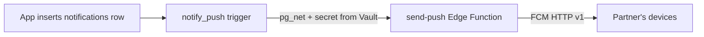

# Feature: Push notifications

Partner actions (touch, doodle, mood change, streak, milestone, location, daily question, chat message) arrive as FCM pushes. Supabase has no mobile push, so Firebase is used for delivery only.

---

## Pipeline

1. **Insert**: `NotificationRepository.notifyPartner` inserts a `notifications` row (`type`, `body_text`, `from_user_id`, `couple_id`).
2. **Trigger** `notify_push` (`push_trigger.sql`): `pg_net` POSTs the row to the function with an `x-webhook-secret` header. The secret is generated in the database and stored in Vault; it is never in code or clients. Errors are swallowed so a push failure never fails the insert.
3. **Edge Function** `supabase/functions/send-push`:
   - Rejects calls without the secret (401).
   - Resolves the recipient as the *other* member of the sender's active couple only.
   - Sends to every device in `device_tokens`; deletes tokens FCM reports as unregistered.
   - Uses the recipient's `silent_types` setting: quiet types use the `usync_silent` channel (no sound/heads-up), others `usync_default`. `locate` belongs to the `location` group; location alerts are quiet by default.
   - `FCM_SERVICE_ACCOUNT` is a Supabase secret.

## The list ("Moments") lives on the phone

The `notifications` row exists only to fire the push. The recipient's phone saves it in the encrypted Hive box `notifications_enc` (`NotificationLocalSource`) and calls the `ack_notifications` RPC, which deletes the row (`notifications_mailbox.sql`). Read state, the "newest touch/location only" collapse and the 50-item cap are all local.

- `NotificationRepository.collect()` does the saving. It runs when the shell opens or the app resumes (`EncryptionSyncGate`), when a push arrives in the foreground, and while the Moments screen is open (a Realtime watch triggers it).
- A row with a sealed detail waits on the server until this phone has the couple key; with the key, a detail that will not open falls back to the fixed sentence.
- Rows a phone never collects are removed by the `trim_notifications` trigger (10 newest per sender) and after 14 days (`purge_old_notifications_for_couple`).
- The saved list is cleared on sign-out and disconnect (with the chat history).

## Message kinds

| Kind | Shown? | Trigger |
|---|---|---|
| Normal (`touch`, `doodle`, `moodChange`, `streak`, `milestone`, `location`, `question`) | Yes | `notifications` insert |
| `locate` | Yes, plus a silent data push, only if recipient allows background location | `notifications` insert (see [location](location.md)) |
| `canvasWidget` | No (data only) | `canvas_strokes` trigger (see [home-widget](home-widget.md)) |

## Client (`PushNotificationService`)

- `init()` requests permission, saves the token (`IAuthRepository.updateFcmToken`, one row per device) and refreshes it on rotation.
- Foreground: shows an in-app snackbar (OS draws none) unless push notifications are turned off in settings; data-only actions (`locate`, `canvas_widget`) are handled silently.
- Background/terminated: `firebaseMessagingBackgroundHandler` (own isolate) handles `locate` and `canvas_widget`; tapping a notification goes to Home and then pushes `/notifications` (or the chat, for a chat notification), so Back lands on Home.

## Security

Only the trigger can call the function; recipients are derived server-side from the couple record, not from client input.
