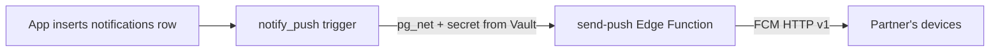

# Feature: Push notifications

Partner actions (touch, doodle, mood change, streak, milestone, location) arrive as FCM pushes. Supabase has no mobile push, so Firebase is used for delivery only.

---

## Pipeline

1. **Insert**: `NotificationRepository.notifyPartner` inserts a `notifications` row (`type`, `body_text`, `from_user_id`, `couple_id`).
2. **Trigger** `notify_push` (`push_trigger.sql`): `pg_net` POSTs the row to the function with an `x-webhook-secret` header. The secret is generated in the database and stored in Vault; it is never in code or clients. Errors are swallowed so a push failure never fails the insert.
3. **Edge Function** `supabase/functions/send-push`:
   - Rejects calls without the secret (401).
   - Resolves the recipient as the *other* member of the sender's active couple only.
   - Sends to every device in `device_tokens`; deletes tokens FCM reports as unregistered.
   - Uses the recipient's `silent_types` setting: quiet types use the `usync_silent` channel (no sound/heads-up), others `usync_default`. `locate` belongs to the `location` group; location alerts are quiet by default.
   - `FCM_SERVICE_ACCOUNT` is a Supabase secret.

## Message kinds

| Kind | Shown? | Trigger |
|---|---|---|
| Normal (`touch`, `doodle`, `moodChange`, `streak`, `milestone`, `location`) | Yes | `notifications` insert |
| `locate` | Yes, plus a silent data push, only if recipient allows background location | `notifications` insert (see [location](location.md)) |
| `canvasWidget` | No (data only) | `canvas_strokes` trigger (see [home-widget](home-widget.md)) |

## Client (`PushNotificationService`)

- `init()` requests permission, saves the token (`IAuthRepository.updateFcmToken`, one row per device) and refreshes it on rotation.
- Foreground: shows an in-app snackbar (OS draws none) unless push notifications are turned off in settings; data-only actions (`locate`, `canvas_widget`) are handled silently.
- Background/terminated: `firebaseMessagingBackgroundHandler` (own isolate) handles `locate` and `canvas_widget`; tapping a notification routes to `/notifications`.

## Security

Only the trigger can call the function; recipients are derived server-side from the couple record, not from client input.
